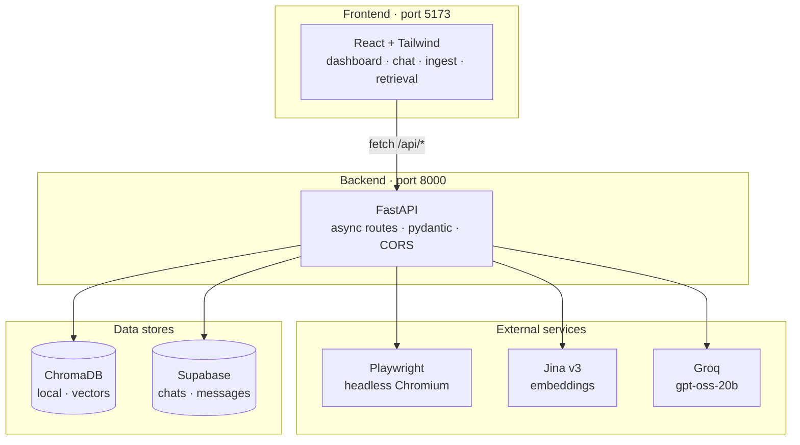
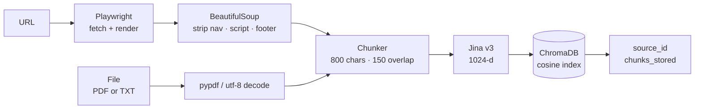
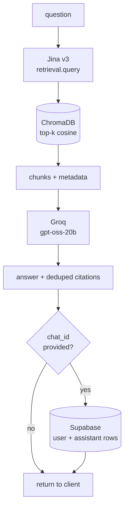
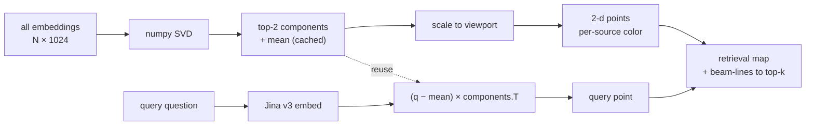

# Scrybe

It writes down what it reads, then answers what you ask.

A self-building knowledge base — feed it URLs and files, ask anything, get grounded answers with citations.

Full-stack: web automation, RAG pipeline, vector search, LLM orchestration, persisted chat.

---

## What it does

You point it at URLs or upload PDFs/TXT. It scrapes, chunks, embeds, and stores everything in a vector store. Then you ask questions through a chat UI and get answers grounded in your sources, with citations you can click through. Every chat is saved to Supabase so you can pick up old threads.

---

## Architecture



---

## Ingest workflow



## Query workflow



## Retrieval map

Every chunk in ChromaDB is projected from 1024-d Jina space to 2-d via numpy PCA, colored per source. Running a query embeds the question, projects it through the same PCA matrix, and overlays it with beam-lines to the top-k hits.



---

## Measured retrieval quality

Every number below comes from a committed artifact under [`evals/results/`](evals/results/).
Nothing here is estimated. Reproduce with the steps in [`evals/README.md`](evals/README.md).

**Corpus:** 35 Wikipedia articles on Python and its ecosystem, pinned by revision id.
**Embeddings:** `jina-embeddings-v3`. **Reranker:** `jina-reranker-v3`. **Retrieval:**
top-10, scored at k=5. Labels come from two independent answer keys
([`retrieval.json`](evals/labels/retrieval.json), model-authored;
[`retrieval-independent.json`](evals/labels/retrieval-independent.json), independently
authored and hand-checked) — they agree on direction and disagree on level, so numbers
below are from the harsher, independent set.

### Before and after reranking — independent labels, 26 queries

| Config | recall@5 | doc recall@5 | nDCG@5 | MRR | chars@5 |
| --- | --- | --- | --- | --- | --- |
| fixed 800/150 · dense (production, no rerank) | 0.596 | 0.846 | 0.521 | 0.530 | 3,921 |
| fixed 800/150 · dense/50 + rerank | 0.750 | 0.827 | 0.673 | 0.699 | 3,978 |
| fixed 800/150 · hybrid/50 + rerank (best measured) | **0.808** | **0.885** | **0.724** | **0.730** | 3,970 |

`dense/50` fetches 50 candidates and reranks down to 10 with a cross-encoder; production
fetches none and reranks nothing. Adding just the reranker lifts recall@5 from 0.596 to
0.750 on identical chunking, for 2% more context. Swapping in hybrid (BM25 + RRF) retrieval
underneath it reaches the best measured result, 0.808.

Production ships without any of this — `services/pipeline.py` still runs dense top-5, no
reranker wired in. The full sweep (chunk sizes, MMR, abstention thresholds, reranker
ceiling analysis, model-authored-label comparison) is committed under
[`evals/results/`](evals/results/) and is reproducible with the commands above.

---

## Tech stack

| Layer        | Choice                  | Why                                  |
|--------------|-------------------------|--------------------------------------|
| Backend      | FastAPI                 | async, pydantic-validated            |
| Scraping     | Playwright              | async-native, handles JS SPAs        |
| Parsing      | BeautifulSoup4 + pypdf  | proven                               |
| Embeddings   | jina-embeddings-v3      | 1024-d, multilingual, task-specific  |
| Vector store | ChromaDB                | persistent, metadata filters         |
| LLM          | Groq · gpt-oss-20b      | hosted, low-latency inference        |
| Persistence  | Supabase (Postgres)     | chats + messages, free tier          |
| Frontend     | React 18 + Tailwind     | in-browser Babel, no build step      |

---

## Setup

Two services. Run them in separate terminals.

### 1. Backend

```bash
cd backend
pip install -r requirements.txt
playwright install chromium
cp .env.example .env        # then fill in keys
uvicorn app.main:app --reload --port 8000
```

Required keys in `backend/.env`:

| Variable                       | Where to get                    | Required |
|--------------------------------|---------------------------------|----------|
| `GROQ_API_KEY`                 | console.groq.com                | yes      |
| `JINA_API_KEY`                 | jina.ai                         | yes      |
| `SUPABASE_URL`                 | supabase.com → project settings | optional |
| `SUPABASE_SERVICE_ROLE_KEY`    | supabase.com → API settings     | optional |

If you set the Supabase vars, paste `backend/supabase_schema.sql` into the Supabase SQL editor once. Without them, chats stay in browser memory only.

### 2. Frontend

```bash
cd frontend
python -m http.server 5173
```

Open `http://localhost:5173`.

---

## Deployment

Backend on Google Cloud Run, frontend on Vercel.

### Backend — Google Cloud Run

The deployed service is `scrybe-api` in project `scrybe-backend`, region `asia-south1`.
Its HTTPS origin is `https://scrybe-api-n526nlzrsa-el.a.run.app`.

Cloud Run builds `backend/Dockerfile` using Cloud Build. The Playwright base image
includes Chromium and its system libraries; its tag and the pinned `playwright`
version in `backend/requirements.txt` must move together. The container reads the
`PORT` supplied by Cloud Run.

The existing project uses these service accounts and secrets:

- `scrybe-build@scrybe-backend.iam.gserviceaccount.com` has the Cloud Run Builder
  role (`roles/run.builder`) on the project.
- `scrybe-runtime@scrybe-backend.iam.gserviceaccount.com` has Secret Manager Secret
  Accessor on the secrets it uses.
- Secret Manager contains `GROQ_API_KEY`, `JINA_API_KEY`, `SUPABASE_URL`, and
  `SUPABASE_SERVICE_ROLE_KEY`. Both Supabase settings must refer to the same project.

To update this existing deployment, run the following from the repository root in
Cloud Shell or an authenticated Google Cloud CLI session. The project must have
billing and the Cloud Run, Cloud Build, Artifact Registry, Secret Manager, and IAM
APIs enabled. The command uses version `1` of each existing secret; change the
version number when deploying a rotated credential.

```bash
gcloud run deploy scrybe-api \
  --source ./backend \
  --project=scrybe-backend \
  --region=asia-south1 \
  --build-service-account="projects/scrybe-backend/serviceAccounts/scrybe-build@scrybe-backend.iam.gserviceaccount.com" \
  --service-account="scrybe-runtime@scrybe-backend.iam.gserviceaccount.com" \
  --allow-unauthenticated \
  --ingress=all \
  --port=8080 \
  --cpu=1 \
  --memory=2Gi \
  --concurrency=1 \
  --min=0 \
  --max=1 \
  --timeout=300 \
  --update-env-vars="CHROMA_PATH=/app/chroma_db,EMBED_CACHE_PATH=/app/.cache/embeddings" \
  --update-secrets="GROQ_API_KEY=GROQ_API_KEY:1,JINA_API_KEY=JINA_API_KEY:1,SUPABASE_URL=SUPABASE_URL:1,SUPABASE_SERVICE_ROLE_KEY=SUPABASE_SERVICE_ROLE_KEY:1"
```

`backend/.gcloudignore` excludes local secrets, indexes, caches, and tests from the
source upload. `backend/.dockerignore` excludes them from the Docker build context.
Backend updates require running the deployment command; this workflow does not
automatically deploy Git pushes. For a new project, follow Google's
[source deployment setup](https://docs.cloud.google.com/run/docs/deploying-source-code)
and [Secret Manager integration](https://docs.cloud.google.com/run/docs/configuring/services/secrets).

After deployment, verify liveness:

```bash
curl --fail-with-body https://scrybe-api-n526nlzrsa-el.a.run.app/api/health
```

Then check ingestion, answers, and saved chat history through the frontend. The
`/api/chats/status` endpoint only confirms that the Supabase settings are present;
it does not test database connectivity. If chats fail, check the Supabase project's
availability and the Cloud Run logs:

```bash
gcloud run services logs read scrybe-api \
  --project=scrybe-backend --region=asia-south1 --limit=50
```

### Frontend — Vercel

No build step. Project root `frontend/`, framework preset **Other**, build command
empty, output directory `.`. Vercel serves `index.html` and the JSX is compiled in the
browser, same as locally.

The backend origin lives in one place, `frontend/api.js`. Setting
`window.SCRYBE_API_BASE` before that script loads overrides it without a redeploy.

### Cloud Run storage and scaling limits

- **The vector index and embedding cache are ephemeral.** They live on the container
  filesystem and are lost when an instance stops. Sources need re-ingestion and
  embeddings may incur new API calls. Supabase chat history is stored separately.
- **Scaling to zero permits cold starts.** With `--min=0`, the first request to a new
  instance waits for startup. The frontend checks `/api/health`.
- **Browser ingestion needs memory headroom.** The deployment allocates 2 GiB and
  processes one request per instance at a time. Increase memory if logs show
  Chromium or the process running out of memory.
- **One instance does not provide durable storage.** Limiting scaling reduces
  independent indexes, but instances can still be replaced. Persistent vectors
  require external storage or a VM with persistent disk.

Google documents the filesystem behavior in the
[Cloud Run container contract](https://docs.cloud.google.com/run/docs/container-contract#file_system).

---

## API reference

| Endpoint                    | Method                | Purpose                                              |
|-----------------------------|-----------------------|------------------------------------------------------|
| `/health`                   | GET                   | liveness                                             |
| `/api/ingest/url`           | POST                  | scrape + index a URL                                 |
| `/api/ingest/file`          | POST                  | upload + index a PDF or TXT                          |
| `/api/sources`              | GET                   | list indexed sources                                 |
| `/api/sources/{id}`         | DELETE                | remove a source (cascade-deletes its chunks)         |
| `/api/query`                | POST                  | retrieve + answer; optional `chat_id` to persist     |
| `/api/chats/status`         | GET                   | whether Supabase is configured                       |
| `/api/chats`                | GET, POST             | list / create chat                                   |
| `/api/chats/{id}`           | GET, PATCH, DELETE    | thread crud                                          |
| `/api/vector_map`           | GET                   | PCA-projected chunks for the retrieval map           |
| `/api/vector_map/query`     | POST                  | project a query + return top-k for the overlay       |

---

## Project layout

```
scrybe/
├── backend/
│   ├── app/
│   │   ├── api/
│   │   │   ├── routes/        ingest · query · sources · chats · vector_map
│   │   │   └── schemas.py
│   │   ├── services/          scraper · chunker · embedder · store ·
│   │   │                      retriever · llm · chats · vector_map
│   │   ├── core/config.py
│   │   └── main.py
│   ├── supabase_schema.sql
│   ├── requirements.txt
│   ├── Dockerfile             playwright base image, for Cloud Run
│   ├── .gcloudignore          source upload exclusions
│   └── .env.example
└── frontend/
    ├── index.html
    ├── api.js                 fetch wrapper
    ├── app.jsx                shell · sidebar · topbar · command palette
    ├── components.jsx         shared primitives
    └── screens/               dashboard · ingest · chat · retrieval · settings
```

---

## Notes

- Prototype scope. No auth, no rate limiting, single workspace.
- Frontend has no build step — Babel compiles JSX in the browser. Hard-refresh after edits.
- Local ChromaDB persists to `backend/chroma_db/` (gitignored); Cloud Run storage is ephemeral.
- Supabase persistence is optional and degrades gracefully when unconfigured.
- Local secrets live in `backend/.env`; Cloud Run reads them from Secret Manager. Never commit secrets.
